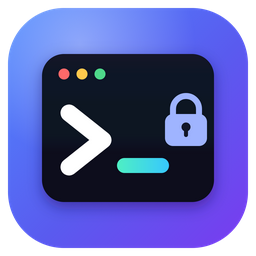
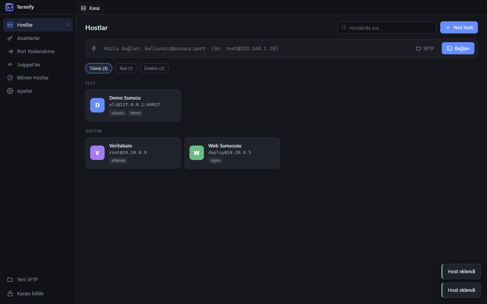

<p align="center">
  
</p>

<h1 align="center">Termify</h1>

<p align="center">
  Türkçe arayüzlü, modern bir masaüstü SSH istemcisi.<br />
  Terminal, SFTP, port yönlendirme ve anahtar yönetimi tek uygulamada.
</p>

<p align="center">
  <a href="https://github.com/Muhammed61/termify-releases/releases/latest"><b>⬇ Windows için indir (.exe)</b></a>
  &nbsp;·&nbsp;
  <a href="https://github.com/Muhammed61/termify-releases/releases/latest"><b>⬇ Mac için indir (.dmg)</b></a>
  &nbsp;·&nbsp;
  <a href="https://github.com/Muhammed61/termify-releases/releases/latest"><b>⬇ Linux / Kali için indir (.deb)</b></a>
</p>



## Kurulum

[Son sürüm](https://github.com/Muhammed61/termify-releases/releases/latest) sayfasının altındaki **Assets** bölümünden bilgisayarınıza uygun dosyayı indirin:

| Bilgisayar | İndirilecek dosya |
|---|---|
| Windows 10 / 11 | `Termify-Setup-x.y.z.exe` |
| Mac (Apple Silicon: M1, M2, M3, M4) | `Termify-x.y.z-arm64.dmg` |
| Mac (Intel işlemcili) | `Termify-x.y.z-x64.dmg` |
| Kali Linux, Debian, Ubuntu (64 bit PC) | `Termify-x.y.z-amd64.deb` |
| Kali Linux ARM (Raspberry Pi vb.) | `Termify-x.y.z-arm64.deb` |
| Diğer Linux dağıtımları (kurulumsuz) | `Termify-x.y.z-x86_64.AppImage` |

Mac'inizin hangisi olduğunu öğrenmek için sol üstteki Apple menüsünden **Bu Mac Hakkında**'ya tıklayın. "Çip: Apple M…" yazıyorsa arm64, "İşlemci: Intel" yazıyorsa x64 dosyasını indirin.

### Windows

1. **Termify-Setup-x.y.z.exe** dosyasını çalıştırın.
2. Kurulum dosyası imzasız olduğu için Windows SmartScreen uyarı verebilir: **Ek bilgi → Yine de çalıştır** deyin.

### Mac

1. **.dmg** dosyasını açın ve Termify simgesini **Uygulamalar** (Applications) klasörüne sürükleyin.
2. Termify'yi Uygulamalar klasöründen açın. Uygulama Apple sertifikasıyla imzalı olmadığı için ilk açılışta uyarı çıkar: **Sistem Ayarları → Gizlilik ve Güvenlik** sayfasının altındaki **Yine de Aç** düğmesine basın.
3. "Termify hasarlı ve açılamıyor" uyarısı çıkarsa **Terminal** uygulamasını açıp şunu bir kez çalıştırın, sonra Termify'yi tekrar açın:
   ```
   xattr -cr /Applications/Termify.app
   ```

macOS 12 (Monterey) veya üstü gerekir. Mac'te kısayollar Ctrl+Shift yerine **Cmd** ile çalışır (Cmd+T yeni bağlantı, Cmd+W sekmeyi kapat, Cmd+D ekranı böl).

### Kali Linux / Debian / Ubuntu

1. **.deb** dosyasını indirin ve indirdiğiniz klasörde terminalden kurun:
   ```
   sudo apt install ./Termify-x.y.z-amd64.deb
   ```
2. Termify'yi uygulama menüsünden (Geliştirme / Development) ya da terminalden `termify` yazarak açın.
3. Termify'yi **root** kullanıcısıyla açıyorsanız Electron güvenlik nedeniyle açılmaz; o durumda `termify --no-sandbox` ile başlatın. Normal kullanıcıyla (Kali'de varsayılan `kali` kullanıcısı) buna gerek yoktur.

Kurulum yapmadan kullanmak isterseniz **.AppImage** dosyasını indirip `chmod +x Termify-x.y.z-x86_64.AppImage` ile çalıştırılabilir yapın ve açın. AppImage için `libfuse2` gerekir; yoksa `sudo apt install libfuse2t64` (eski sürümlerde `libfuse2`) ile kurun.

İlk açılışta bir ana parola veya 4 haneli PIN belirleyin. Hostlarınız, parolalarınız ve anahtarlarınız bununla şifrelenir. Size verilen **kurtarma anahtarını** saklayın; parolanızı unutursanız onunla yeni parola belirlersiniz.

## İndirilen dosyayı doğrulama

v1.0.5 ve sonraki sürümlerde her kurulum dosyası için iki doğrulama yolu vardır:

**1. SHA256 özeti:** dosyanın indirirken bozulmadığını veya değiştirilmediğini gösterir. Sürüm sayfasındaki `SHA256SUMS.txt` içindeki değerle karşılaştırın:

- Windows (PowerShell): `Get-FileHash .\Termify-Setup-x.y.z.exe -Algorithm SHA256`
- macOS: `shasum -a 256 Termify-x.y.z-arm64.dmg`
- Linux: `sha256sum -c SHA256SUMS.txt --ignore-missing`

**2. Derleme kanıtı:** dosyanın [Muhammed61/termify](https://github.com/Muhammed61/termify) deposundaki açık kaynak koddan, GitHub Actions'ta derlendiğini kanıtlar. Kanıt Sigstore ile imzalıdır ve GitHub'da herkese açık saklanır. [GitHub CLI](https://cli.github.com) kuruluysa:

```
gh attestation verify Termify-Setup-x.y.z.exe --repo Muhammed61/termify
```

Komut `Verification succeeded` derse dosya o depodaki koddan derlenmiştir ve sonradan değiştirilmemiştir. Kurulum dosyaları henüz bir kod imzalama sertifikasıyla imzalı olmadığı için Windows ve macOS ilk açılışta uyarı gösterebilir; bu doğrulama o uyarının yerine geçmez ama dosyanın gerçekten bu projeden geldiğini gösterir.

## Güncellemeler

Termify yeni sürümleri kendisi denetler. Yeni sürüm çıktığında ekranın üstünde bildirim görünür. Verileriniz her iki durumda da korunur.

- **Windows:** **Şimdi güncelle** dediğinizde indirilir, kurulur ve uygulama yeniden açılır.
- **Linux:** .deb kurulumunda **Şimdi güncelle** dediğinizde yönetici parolanız sorulur, ardından güncellenip yeniden açılır. AppImage kendini parola sormadan günceller.
- **Mac:** **İndir** dediğinizde yeni .dmg dosyası tarayıcıda iner; açıp Termify'yi yine Uygulamalar klasörüne sürükleyin (eskisinin yerine geçer).

## Özellikler

- Şifreli kasa (AES-256-GCM) ve otomatik kilit
- Hostlar: gruplar, etiketler, hızlı bağlan, atlama sunucusu
- Terminal: sekmeler, bölünmüş ekran, yayın modu, arama, 8 renk teması
- SFTP: çift panel, sürükle-bırak, uzak dosya düzenleme
- SSH anahtarı üretme/içe aktarma, tek tıkla sunucuya yükleme
- Port yönlendirme: yerel, uzak ve SOCKS5
- Snippet'ler, bilinen hostlar, şifreli yedekleme

Bu depo kurulum dosyalarını barındırır. Termify açık kaynaklıdır (MIT lisansı); kaynak kod, hata bildirimleri ve katkılar için: **[github.com/Muhammed61/termify](https://github.com/Muhammed61/termify)**
